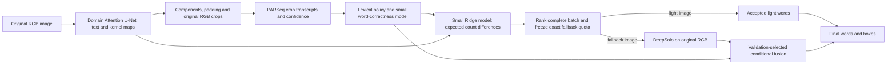

# Uniform U-Net, word-risk routing and conditional fusion

**Approximate reproduction / active research extension, 2026-10-30.** The user
requests a genuinely shared U-Net training and inference method on Total-Text,
ICDAR2013 and ICDAR2015, followed by one trained router formula and conditional
DeepSolo/light fusion. Nominal lexical micro F1 targets are strictly above
79.8%, 89.7% and 78.2%, respectively. These paper-number comparisons do not
establish equality with Table 5's recognition metric or official spatial Hmean.
Do not claim completion until all full TEST outputs and audits exist.

Current status: v3–v5 full TEST audits are complete. V5 passes all three
nominal targets at the exploratory common95% fallback control, but primary
IC13 and the validation-frozen common80% control still fail. Three real RGB
pipeline smokes and the shared encoder projection qualify. The intended budget
objective remains open; high fallback adds cost and is not a useful completion.

## Frozen first experiment

Use one Text+Kernel Attention U-Net topology for every domain: ResNet50,
2048-to1024 bottleneck, four attention decoder stages 512/256/128/64, residual
skip floor .25, two 1x1 output heads, RGB768/native384, ImageNet normalization
and letterbox. Every network receives the identical strictly loaded Total-Text
decoder/source state and the identical qualified text-pretrained ResNet50 encoder.
The encoder and its BN parameters/statistics remain frozen. Train a separate
decoder for each dataset on its own FIT images only. No dataset-specific loss
weight, mixed auxiliary corpus, GNN, RGB verifier, text editor or YOLO expert
is introduced. This differs from the prior mixed-TT ICDAR13 training.

The shared training recipe is 30 epochs, AdamW1e-4, weight decay1e-4,
per-image masked BCE+Dice for both text and kernel, kernel weight1,
separator-background weight3, kernel distance fraction.5, clipping5,
FP32/noTF32, physical4/accumulation2, seed20261030. No reflection or rotation.
Evaluate epoch0 and every5 epochs with the same fixed proposal/PARSeq settings;
choose highest validation lexical micro F1, retaining the earliest exact tie.
The initial state remains an explicitly identified baseline candidate: if it
wins, report that retraining failed to improve it, rather than calling it a
newly learned selected checkpoint. Keep only best and resumable last weights.
Every epoch records loss, complete image-order hash, optimizer steps and CUDA
allocated/reserved peaks. Exceptions and OOM produce explicit failure receipts.

| Dataset | FIT | Selection (pooled prior selection/CAL) | Complete TEST | Primary DeepSolo quota |
| --- | ---: | ---: | ---: | --- |
| Total-Text |1128|125|300|150/300 (50.00%)|
| ICDAR2013 |183|46|233|61/233 (26.18%)|
| ICDAR2015 |900|100|500|228/500 (45.60%)|

Preserve exact role membership and decoded-RGB disjointness. The user explicitly
allows larger fallback quotas if needed, while retaining these primary quotas
as the objective. Additional fractions are declared before TEST; TEST labels
must not choose or silently increase a deployment quota.

After training qualification, use the same finite text/kernel/padding/PARSeq
emission grid for all three datasets. Freeze each selected operating point on
selection only. Fit the same HistGradientBoosting word-correctness model
(100 iterations,7 leaves,min leaf20,L2=10) using FIT labels and five RGB-grouped
word folds. Inference features use OCR/token confidence, geometry and explicit
lexical traces; no GT or actual DeepSolo output enters pre-fallback scoring.
The sole image score family is negative expected word errors, including the
probability mass of rejected candidates. Do not select different image-score
families for different datasets. Admission/fusion thresholds can be fitted per
dataset from the same declared finite grid, with the same selection rule.

Rank the full image batch deterministically by score, RGB hash and sample ID,
keeping exactly N-K light images. After routing, greedily match existing light
words one-to-one to selected DeepSolo boxes. Compare identity and the same
confidence/IoU/edit-distance replacement grid, plus the same spatially distinct
high-confidence complement options. Dataset-specific qualified DeepSolo and
benchmark vocabulary resources remain explicit inputs. No extra caption/map
encoder or fallback PARSeq reading is added.

## Metric, limitations and cost assessment

Use exact per-image Unicode-casefold/alphanumeric word multisets, summed micro
TP/FP/FN, inherited native256 care/ignore, all care GT and empty denominators.
Empty normalized predictions cannot match and remain FP when emitted; empty
care GT remain FN. F1 with a zero aggregate denominator is0. Ignore assignments
are metric-only. Prediction generation uses original RGB and predicted maps.
Original GT/masks are preserved; source loss targets may lose tiny words at
native resolution, which must be counted in target audits and never removed
from evaluation denominators.

Upstream text pretraining includes benchmark TRAIN, including current heldout
images; the Total-Text warm start and previous experiments have historical
exposure. Word-fold training does not make the source U-Net image-excluded or
establish unbiased end-to-end OOF. Reused validation, adaptive historical TEST
research and allowed vocabularies remain material limitations. This first
experiment uses no new package installation and qualifies the actual RTX3090,
not the historical RTX3070.

The final user requirement also asks whether the pipeline becomes too large or
computationally intensive. Inventory neural parameters, CPU router size, crop
counts, per-stage measured time, allocated/reserved VRAM, and real/logical
DeepSolo calls. Account for the fact that U-Net/PARSeq runs before fallback,
including on fallback images. Compare the selected fallback fractions and the
up-to50 crop bound with the paper's10-block bound. Timing over cached experts
does not establish online speedup. Do not add major neural modules to rescue a
metric without first reporting their cost and the resulting change in scope.

## Execution and disk cleanup

Entry points: `scripts/run_uniform_unet_training.py`,
`scripts/supervise_uniform_unet_training.py`,
`scripts/audit_uniform_unet_training.py`; shared boundaries:
`segmentation/uniform_unet_fusion.py`. Explicit profile:
`configs/approximate/uniform_unet_fusion_v1.json`.
External root: `/extra1/bmartelli/context-str-runs/uniform-unet-fusion-20261030-v1`.
The supervisor waits for adequate GPU memory without interrupting other jobs;
it requires all three real GPU smokes and independent audits before full fits.
The training source is frozen and executed from each run's source snapshot.
Router fitting/full evaluation remain required subsequent stages.

The initial disk check found about7.8GB free. The user explicitly authorized
removing obsolete non-improving checkpoints. `disk_cleanup_plan_v1.json` and
`disk_cleanup_applied_v1.json` record19 removed OHEM-full validation snapshots,
12.06GiB reclaimed, original SHA256, epoch, validation scores and file identity.
The completed100-epoch run selected epoch0; each removed epoch failed to improve
both raw and emitted validation word F1. Preserve selected best, resumable last,
geometry-best epoch12, final epoch100 and all reports/masks/OCR/history. Deleted
intermediate weights cannot be rerun without a backup; historical reports remain.

Engineering preflight first exposed missing optional per-word counts in the
Total-Text manifest, then degenerate clipped ignore polygons when reconstructing
validity. Counts now come from original annotations where absent; Total-Text
evaluation uses its qualified saved validity boundary instead of repainting.
These failures occurred before any new GPU optimization and are recorded rather
than interpreted as model-quality failures. The focused suite passes18
tests. Genuine GPU smoke and full training statuses must be read from their
separate receipts; no new TEST result is yet claimed.

Classification: PAPER_SPECIFIED broad Attention-U-Net/crop/fallback motivation;
REPOSITORY_SPECIFIED authenticated datasets, states, target geometry and metric
boundaries; ASSUMPTION common two-head architecture/initialization/training,
finite emission/risk/fusion selection and quota policies; HARDWARE_DEVIATION
actual RTX3090 FP32 physical4/accumulation2, sequential inference and CPU heads;
UNRESOLVED strict checkpoint/metric equivalence, upstream exposure,
generalization, attaining all three targets and final end-to-end cost.

## Initial execution qualification

All three real one-epoch GPU smokes and their independent state/order/word-count
audits pass. Each model has58,155,146 parameters,32,598,114 trainable. All use
the same FP32 physical4/accumulation2 recipe. Each smoke's training peak is
4,652,862,464 allocated /6,194,987,008 reserved CUDA bytes; these are engineering
measurements, not full-TEST quality or pipeline latency. The full sequential
retrainings are active, beginning with ICDAR2013.

Native target audits cover all229/1000/1253 TRAIN images and849/4448/9268 care
words on IC13/IC15/TT. IC13 loses/fragments no word. IC15 has2 native-missing
and6 fragmented words; TT has0 missing and6 fragmented words. There are no
unexpected owners or inter-word contacts. These source/native limitations are
retained in per-image audits and every original care word stays in evaluation.

A second authorized cleanup removes16 non-improving intermediate OHEM-partial
snapshots from another completed100-epoch run selected at epoch0. Preserve best,
last, final epoch100 and all evidence. `disk_cleanup_plan_v2.json` and
`disk_cleanup_applied_v2.json` bind their hashes and scores. Combined recovery is
22.0495GiB from35 snapshots; free space immediately after the second cleanup is
26.17GiB, subject to concurrently running experiments.

The posttraining supervisor uses its own immutable source snapshot. It waits for
each full U-Net audit, selects emissions on validation, exports real TRAIN
predictions, fits/audits the uniform word-risk/fusion gate, then exports RGB-only
TEST frontend predictions only after that gate is frozen and qualified.
`recognition/uniform_risk_fusion.py` fixes the image-score formula for all domains;
`scripts/train_uniform_risk_fusion.py` and its auditor record every policy trial
and independently replay word-model fits and routing counts. The separate
`uniform_unet_router_v1.json` profile pins authenticated TRAIN fallback sources.
Full TEST evaluation, comparisons and the final computational-cost assessment
remain required. No final performance target is yet claimed.

## Completed initial full TEST evaluation (negative result)

All three30-epoch U-Net fits,6 total neural smoke/full training audits,
18 word-model refits in router audits and the complete TEST frontend exports
finished. The selected U-Net epochs are25/30/15 for IC13/IC15/TT. Independent
TEST audits replay2,097/3,500/1,800 policy-image decisions and word counts.

| Dataset | Initial uniform lexical micro F1 % | Required point % | DeepSolo images/total (%) |
| --- | ---: | ---: | --- |
| ICDAR2013 |83.3412|>89.7|61/233 (26.18%)|
| ICDAR2015 |75.0334|>78.2|228/500 (45.60%)|
| Total-Text |79.6006|>79.8|150/300 (50.00%)|

The initial common method fails all three primary targets. Larger predeclared
quota results remain descriptive, not TEST-selected deployment thresholds.
IC13's validation-selected fusion is harmful even at233/233 (100%) fallback:
88.6018% versus native DeepSolo90.1707%, also233/233 (100%). IC15 reaches
78.7402% at300/500 (60%), TT80.4187% at180/300 (60%), but these TEST points
cannot retroactively select validation thresholds. Preserve all original rows.
The results use real new frontend inference and authenticated cached fallbacks,
with zero new DeepSolo neural calls; there is no online speedup claim.

## Shared lexical/utility control declared after initial TEST exposure

Keep the already uniformly retrained networks and genuine raw crop readings
fixed. The new common control first selects from the same sequence cutoff and
prediction-only lexical correction grid on native TRAIN validation. Identity is
eligible. IC13 supplies its existing benchmark Generic resource, IC15 Weak, and
TT explicitly supplies no vocabulary. TRAIN lexicons include official TRAIN
transcripts including validation, as in the qualified benchmark-side-information
condition; this is not vocabulary-independent holdout generalization. No TEST
vocabulary is used in fitting or selection. Preserve original source indices,
confidence origins, care words and empty denominators.

The completed validation-only lexical control selects sequence.7/Generic reject
on IC13 (85.8934%,0/46 (0%) fallback), sequence.4/Weak reject on IC15
(67.1623%,0/100 (0%)), and sequence.7/identity on TT (67.1074%,0/125 (0%)).
These are standalone validation numbers, not new TEST achievements.

Next fit the identical HGB word-correctness recipe and a two-output Ridge image
utility model in all three domains. Both light-minus-DeepSolo count targets,
word-fold method, seven observable feature groups and F1-utility formula are
common; alpha and admission can be validation-selected from the same finite
grid. Real predicted text/kernel coverage comes from the already required
U-Net, adding no encoder. This addresses omitted-text information absent from
the first raw expected-error score. FIT-only word folds remain conditional on
FIT-seen neural experts. Do not call them end-to-end expert OOF.

Freeze the image gate before selecting fusion. Compare the same replacement
and complement grid against identity on its fixed validation route. Identity
is always eligible. Other policies require a strictly positive one-sided.05
paired-image bootstrap lower gain; within0.1 F1 points prefer fewer changed
words. This is an exploratory conservative selection heuristic after candidate
search, not a formal post-selection risk guarantee. Additional95/97.5/99%
fallback fractions are explicitly declared now, before this control's TEST
evaluation, because the user permits larger quotas. Historical v1 TEST exposure
and adaptive research design remain material limitations.

Implementation: `recognition/uniform_lexical_risk.py`,
`recognition/uniform_utility_fusion.py`,
`scripts/select_uniform_lexical_policy.py`,
`scripts/train_uniform_utility_fusion.py`. Profiles:
`uniform_lexical_control_v2.json`, `uniform_utility_fusion_v2.json`.
The original uniform U-Net architecture/training remains shared across all
three datasets. This control adds only compact CPU models and postprocessing;
it does not add a neural expert or fallback rereading. Full TEST evaluation,
independent qualification and final cost assessment remain outstanding.

## Completed lexical/utility control (v2)

The full TEST independent audits pass:2,796/5,000/2,700 policy-image replays
on IC13/IC15/TT, respectively. They independently rank the observable utility
scores, recount per-image multisets with a separate Counter implementation,
verify every aggregate/denominator and check source/model/map hashes. This
still shares the declared feature and fusion geometry primitives.

| Dataset | Primary lexical micro F1 % | Required point % | DeepSolo images/total (%) |
| --- | ---: | ---: | --- |
| ICDAR2013 |85.2743|>89.7|61/233 (26.18%)|
| ICDAR2015 |79.6242|>78.2|228/500 (45.60%)|
| Total-Text |77.7943|>79.8|150/300 (50.00%)|

IC15 now passes its primary target. TT gives80.2033% at210/300 (70.00%);
this is a predeclared descriptive TEST point, not a TEST-selected deployment
quota. The common90% fallback control was chosen before TEST from validation:
IC13 gives88.9921% at210/233 (90.13%), IC15 gives82.5942% at450/500 (90.00%),
and TT gives81.3260% at270/300 (90.00%). It still fails IC13. IC13 reaches
89.8939% at231/233 (99.14%), saving only two heavy calls; do not present this
as the intended useful solution. Full descriptive grids remain in the external
`utility_fusion_v2/<dataset>/evaluation/results.json` files. All are cached
logical routing replays, with zero new neural inference and no online latency
claim. Paper Table5 accuracy equivalence remains unresolved.

A separate privileged TEST-label diagnostic chooses whole-image light versus
native DeepSolo outputs perfectly, without changing their words or boxes. At
the primary quotas its ceilings are90.1057% on IC13,61/233 (26.18%);
84.0595% on IC15,228/500 (45.60%); and83.8804% on TT,150/300 (50.00%).
These are nondeployable oracles, not trained results. Their accepted image IDs
must never enter training or inference. They motivate investigating routing
generalization, while providing no guarantee that an observable gate can
attain the ceiling. See `utility_privileged_oracles_v2.json` externally.

## Conditional decoder-heldout supervision (v3, pending)

Use one identical protocol across all three domains: split original native FIT
into five decoded-RGB groups, initialize every fold from the same original
qualified state, and train on the other four groups. Use the already selected
global epoch count (25/30/15 on IC13/IC15/TT) and global validation-selected
crop policy, without using heldout labels to select fold checkpoints. The
loss, optimizer, frozen encoder, seed, precision and effective batch remain
the shared v1 recipe. This adds15 offline fits,193,980 training image-epochs,
plus one small real GPU engineering smoke. It adds no runtime neural model.

Generate raw PARSeq readings and actual U-Net maps on each decoder-heldout
group from RGB alone. Independently audit learned state, complete epoch order,
crop pixels, hashes and exact unique FIT coverage before a bank may replace
FIT observations in the common utility fitter. Validation and TEST continue
using the original qualified full-FIT deployment U-Net. Missing, changed or
incomplete banks fail explicitly; there is no fallback to FIT-seen predictions.
Refit the same word/ridge/fusion family and finite selection rules for all
three datasets, preserving the v2 control and all negative results.

This is conditional decoder exclusion, not unbiased end-to-end OOF: the frozen
text encoder and initial decoder have upstream exposure; global epoch/crop
selection and TRAIN vocabularies are shared across folds; stacking folds are
not fully nested; validation and historical TEST have already been explored.
Do not claim that this procedure resolves any of those limitations.

Resource policy: verify actual GPU memory before every train/export, wait for
at least10GiB without interrupting other processes, reserve6GiB disk, retain
resumable optimizer state for incomplete fits, and qualify a smoke before all
full folds. After a completed fixed-budget fold passes independent training
and crop-export audits, remove only its redundant optimizer-bearing `last.pt`:
the audit first compares every learned tensor with preserved `final.pt`.
Keep final weights, all histories, maps, OCR, hashes and compaction receipts.
This discards optimizer continuation of an already completed fold explicitly;
it never removes selected deployment weights or prior evidence.

Entry points: `scripts/manage_uniform_decoder_oof.py`,
`scripts/uniform_decoder_folds.py`; profile
`configs/approximate/uniform_decoder_oof_v3.json`; external root
`decoder_oof_v3` under the main experiment. The source is frozen before GPU
execution. No v3 smoke, full-fold qualification or target achievement is yet
claimed; read actual supervisor and audit receipts for progress.

The independently frozen CPU successor
`scripts/supervise_uniform_utility_oof.py` waits for all qualified banks, then
generates the pinned `uniform_utility_fusion_v3.json` profile, fits/audits every
common gate, freezes a validation-only shared operating fraction, and finally
evaluates/audits complete TEST. Its orchestration profile is
`configs/approximate/uniform_utility_oof_supervisor_v3.json`; progress is external
under `utility_oof_supervision_v3`. It never automatically declares the user's
goal complete from the existence of result files.

## Current router and inference path explained

The same procedure is used for IC13, IC15 and TT. Learned weights and finite
validation-selected thresholds are domain-specific. IC13/IC15 also supply their
explicit benchmark Generic/Weak dictionaries; TT supplies none. This does not
introduce a different router architecture for IC13. It is a learned research
router and differs from the paper's BLIP2/MPNet/fuzzy Algorithm2.

Three decisions have different purposes. First, the word model estimates a
correctness probability for each original PARSeq candidate. It uses18 scalar
OCR/token, geometry and lexical-trace features. A frozen threshold can reject
unlikely words. Second, the image router estimates whether retaining the
whole light result is preferable to running DeepSolo. It does not compare
the two actual expert outputs: DeepSolo has not run at this point. The Ridge
head uses confidence, tokens, lexical traces, predicted U-Net map coverage,
geometry and word-risk summaries to predict two normalized differences:

* `delta_TP`: light true-positive count minus DeepSolo true-positive count.
* `delta_N`: light emitted care-word count minus DeepSolo emitted care-word count.

Rescale both predicted differences by the observable raw candidate count plus1.
The image utility score is `2 * predicted_delta_TP - reference_F1 *
predicted_delta_N`, where `reference_F1` is DeepSolo's aggregate FIT F1.
This is the declared F1-oriented surrogate, not a calibrated probability or
knowledge of TEST correctness. Higher scores favor the light branch. For a
batch ofN images and quotaK, keep exactlyN-K eligible images with highest score;
ties use decoded-RGB hash and sample ID. Send the remainingK images to DeepSolo.
This requires a batch; an independent per-image online threshold is not
qualified by these exact-quota experiments.

Third, fusion acts only after DeepSolo has returned on the selected images.
It begins with the DeepSolo words, matches light and heavy boxes one-to-one,
and may replace a matched transcript if the frozen IoU, word-probability and
edit-distance conditions pass. A separately frozen option may add a spatially
distinct confident light word. Identity leaves the heavy result intact and is
always a candidate; IC13 v2 selects identity at every tested quota. Validation
chooses from the same grid and conservative gain rule in every domain. Fusion
cannot influence the earlier image decision using an unseen heavy output.

## Measured asset inventory before v3 results

CPU loading of the pinned genuine PARSeq checkpoint confirms23,832,671
parameters; each common U-Net has58,155,146. Their combined81,987,817 neural
parameters already exceed the qualified ViTAEv2-S/TextOCR DeepSolo's33,748,854
parameters. Including the conditional fallback gives115,736,671 distinct
parameters for one domain, with sequential placement. Parameter count is not
FLOPs or latency, but the full pipeline cannot be called smaller merely
because its CPU gate is small. The v2 deployed word model plus chosen Ridge
bundle occupies about120KB per domain; training-only fold models are excluded.

| Dataset | Actual TEST PARSeq crops | Mean / maximum crops per image | Frontend export seconds | Primary logical DeepSolo images/total (%) |
| --- | ---: | --- | ---: | --- |
| ICDAR2013 |1357|5.824 /28|92.666|61/233 (26.18%)|
| ICDAR2015 |2944|5.888 /35|117.908|228/500 (45.60%)|
| Total-Text |2907|9.690 /50|80.102|150/300 (50.00%)|

The shared frontend runs FP32 U-Net batch1 and PARSeq crop batch32. Its
measured allocated peak is763,219,968 bytes and reserved peak855,638,016 to
857,735,168 bytes. These times were measured during export with shared GPU
activity, include serialization, exclude model loading and DeepSolo, and do
not establish online speedup. The neural crop cap is50 versus paper10.
Every fallback image incurs the frontend work as well as DeepSolo. A matched
live full-pipeline versus heavy-only timing remains required before a speed
claim. Full inventory: external `asset_inventory_v2.json`.

## U-Net tensor path and localization details

All shapes below describe one768-square letterboxed RGB input, with dimensions
`channels x height x width`. They describe the qualified common implementation;
the paper does not uniquely specify all of these engineering choices.

| Stage | Output shape | Operation / purpose |
| --- | --- | --- |
| RGB input |3 x768 x768|Preserve aspect ratio, pad and apply ImageNet normalization|
| ResNet stem `e0` |64 x384 x384|7x7 stride2 convolution, BN, ReLU|
| ResNet `layer1`, `e1` |256 x192 x192|Max-pool and residual bottleneck blocks|
| ResNet `layer2`, `e2` |512 x96 x96|Residual downsampling|
| ResNet `layer3`, `e3` |1024 x48 x48|Residual downsampling|
| ResNet `layer4`, `e4` |2048 x24 x24|Deepest semantic features|
| Compressed bottleneck |1024 x24 x24|3x3 convolution, BN, ReLU|
| Decoder `up3` |512 x48 x48|Upsample and fuse gated `e3`|
| Decoder `up2` |256 x96 x96|Upsample and fuse gated `e2`|
| Decoder `up1` |128 x192 x192|Upsample and fuse gated `e1`|
| Decoder `up0` |64 x384 x384|Upsample and fuse gated `e0`|
| Final1x1 projection |2 x384 x384|Independent text and word-kernel logits|

Each decoder stage upsamples by nearest neighbor, reduces channels with1x1
convolution/BN/ReLU, gates its encoder skip, concatenates the two tensors and
applies the two-convolution decoder block. The attention gate uses separate
1x1 projections and BN for the decoder signal and encoder skip, adds them,
then applies ReLU, a1x1 single-channel projection and sigmoid. The skip is
multiplied by `.25 + .75 * attention`, broadcast across its channels. The.25
floor is an explicit research assumption; it prevents complete skip removal.
This spatial attention is internal to segmentation and is different from the
image router that decides whether DeepSolo should run.

The text head covers word foreground; the kernel head predicts smaller word
cores so adjacent words can retain separate instance IDs. During training,
each original word-owner region is shrunk by its normalized distance transform
(fraction.5), retaining its largest connected core. No GT owner map is used at
inference. Both heads use masked BCE plus Dice, each coefficient1, Dice
smooth1; the text BCE receives separator-background weight3, and the kernel
loss has overall weight1. The shared trainer averages per-image losses before
effective-batch averaging. The whole encoder, including BN statistics, stays
frozen; the bottleneck, decoder, gates and two output channels learn.

At inference, threshold predicted text and kernel maps, remove letterbox
padding, label kernel components and expand all seeds simultaneously inside
predicted foreground using eight-neighbor breadth-first propagation. A text
component with no seed remains one instance. Convert the resulting instance
envelopes back to original-image coordinates, clip and pad, then read the
original RGB crops with PARSeq. This two-map expansion is an explicit
approximation; it differs from the paper's single-mask contour Algorithm1.
Component ordering and the50-candidate limit belong to this declared research
path, without changing the strict10-block implementation.

The same validation emission grid selects text/kernel thresholds.5/.5 for
all three datasets; original-frame padding is4/0/2 pixels on IC13/IC15/TT.
The v2 lexical control subsequently selects sequence cutoffs.7/.4/.7 from raw
crop readings, superseding the initial emission acceptance cutoff for the
v2/v3 router. These different fitted values follow the same selection method.

## One RGB inference entry point and fallback parity

`pipeline/uniform_word_pipeline.py` and
`scripts/infer_uniform_word_pipeline.py` connect the qualified common full-FIT
U-Net, original RGB crops, genuine PARSeq, small utility gate and conditional
DeepSolo subprocess. The input manifest accepts only `sample_id` and
`image_path` per image. It derives dimensions, EXIF orientation and image/pixel
hashes itself. Annotation fields and colliding/unsafe file IDs are rejected.
Save the exact route before any fallback output is read or generated. Unload
frontend models before starting the existing isolated legacy worker, then
apply the common prediction-only postprocessor and frozen fusion. Errors
propagate and prevent a completion receipt; they never trigger substitute OCR.

For a batch size different from the reference TEST population, the explicitly
declared engineering rule is `ceil(reference_K * batch_N / reference_N)`.
This keeps the exact61/233 (26.18%),228/500 (45.60%) and150/300 (50.00%) primary
budgets on the full native populations; rounding changes the actual fraction
on smaller batches and every receipt records its actualK/N and percentage.
This rescaling is an ASSUMPTION, not an independently qualified streaming gate.

The fallback interface is common, while qualified resources remain explicit:

| Dataset | ViTAEv2-S checkpoint SHA prefix | Native shortest / maximum | Score / character-confidence cut | Benchmark vocabulary rule |
| --- | --- | --- | --- | --- |
| ICDAR2013 |54d3a454ecc7|1024 /1892|.40 /.00|Generic, keep unmatched|
| ICDAR2015 |c0aac6fddc29|1440 /4000|.35 /.85|Weak, reject unmatched|
| Total-Text |54d3a454ecc7|1024 /1892|.35 /.925|None|

Both qualified domain checkpoint architectures contain33,748,854 parameters.
The U-Net initialization's R50 checkpoint `ac2a01b3...` is a separate encoder
donor, not the online fallback. Keeping these identities separate prevents a
silent model substitution. The router family remains identical on IC13/IC15/TT.

`recognition/uniform_fallback.py` reproduces exact admitted IDs, text, scores,
clipped envelopes and original polygons for all233/500/300 cached TEST images
(1,072/1,872/2,071 emitted word rows). The deployed function receives only raw
neural responses, RGB dimensions/orientation and the bound checkpoint identity;
no annotations or ignore labels. Its independent parity audit uses the old
qualified results as reference. It adds zero neural calls and makes no new
quality or latency claim. Portable receipt:
`provenance/UNIFORM_FALLBACK_PARITY_V1.json`.

Profile: `configs/approximate/uniform_pipeline_deployment_v2.json` with
`uniform_fallback_profiles_v1.json`. This is the already evaluated v2 control,
whose primary IC13/TT targets remain unmet. RGB-only12-image engineering
manifests are prepared externally under `deployment_boundary_v1`; no live
full-pipeline GPU qualification is yet claimed. Unit tests cover input hashes,
coordinate metadata, budget rounding, lexical boundaries, duplicated words,
invalid clipped envelopes, and subprocess failure propagation after a frozen
annotation-free route. Actual CUDA smoke and matched heavy-only timing remain
required; the GPU is currently occupied and existing jobs are preserved.

## Declared U-Net operation count

The same strictly loaded checkpoint was profiled on CPU FP32, batch1, using
zero RGB tensors solely for engineering shape/operation qualification. At
256-square input it emits2x128x128 and reports33,033,923,072 operations; at
768-square it emits2x384x384 and reports297,305,307,648, exactly nine times as
many. The latter contains297,270,116,352 convolution FLOPs, plus reported
elementwise add/multiply operations. This counts convolution multiplication
and addition separately under PyTorch2.4.1 `profiler(with_flops=True)`.
BN, activations, interpolation, other unreported operations and memory traffic
are excluded; it is not a complete hardware cost or a measured GPU time.

Entry point: `scripts/profile_uniform_unet_compute.py`, with explicit input
sizes, checkpoint run directory, CPU threads and output path. The preserved
`unet_compute_profile.json` initially described its operator scope too narrowly;
`unet_compute_profile_v2.json` corrects the description and separately records
convolution operations, with identical measured counts. Both source hashes and
operator lists are retained externally. Paper FLOP-convention equivalence and
the complete PARSeq/DeepSolo cost remain UNRESOLVED. The higher resolution is
already a material computational increase before adding any fallback call.

## Completed v3 and real RGB-chain engineering qualification

All15 conditional decoder fits, complete heldout banks,3 router audits and3
full TEST audits pass. Primary lexical F1: IC13 83.5792%,61/233 (26.18%);
IC15 80.7427%,228/500 (45.60%); TT80.0578%,150/300 (50.00%). The common
validation-frozen80% control gives IC13 87.0344%,187/233 (80.26%),
IC15 82.9956%,400/500 (80.00%), TT81.8419%,240/300 (80.00%); it still
fails IC13. These are authenticated cached full-TEST replays, with zero new
DeepSolo neural calls, not an equivalence proof with paper Table5 accuracy.

The RGB-only deployed chain also passes all3 real12-image smokes and independent
engineering audits. It runs exactly4/12 (33.33%),6/12 (50.00%),6/12 (50.00%)
actual DeepSolo calls on IC13/IC15/TT, respectively, and12 new U-Net calls
each. PARSeq reads71/96/95 original crops. No GT is passed to inference,
no selected image is omitted and no OOM occurs. IC15 fallback peaks at
6,947,943,936 allocated /12,215,910,400 reserved bytes on RTX3090; this
does not qualify the declared profile on8GB hardware. Main frontend peaks
at763,219,968 allocated bytes. See portable v3 evaluation and RGB smoke receipts.

A same-image12-image heavy-only engineering control makes12/12 (100.00%)
actual DeepSolo calls per domain. One cold batch gives pipeline versus
heavy-only wall seconds: IC13 27.179 versus8.929 (pipeline4/12,33.33%;
heavy12/12,100.00%), IC15 14.323 versus13.334 (6/12,50.00%;12/12,100.00%),
TT12.101 versus8.280 (6/12,50.00%;12/12,100.00%). Startup and serialization
are included; order is pipeline first then control, with one repetition and
no warm randomized benchmark. These small cold-batch observations establish
no general speedup and warn that fewer heavy calls do not remove frontend cost.
The first control launch failed before inference because its external script
lacked a module search path; its receipt is retained. Supplying the frozen
source snapshot through PYTHONPATH repairs only invocation, with no parameter
change. Source, plans, raw outputs, memory and comparison JSON remain external
under `live_pipeline_smoke_v3`.

V4 retains every neural weight, decoder bank, lexical policy, word-risk model
family, observable feature, count target and fusion rule. It fits the same HGB
two-count image-regression family on all3 domains (100 iterations,3/7 leaves,
minimum leaf10,L2 10/100), selects from that shared finite grid on validation,
and independently refits/audits before any v4 TEST metric is read. This adds
only compact CPU models. The adaptive prior TEST exposure remains explicit.

## V4 result and shared encoder reuse (v5)

V4 full TEST audits pass but IC13 remains below target at useful budgets:
primary82.9712%,61/233 (26.18%); its first passing descriptive point is
90.1202%,228/233 (97.85%). IC15 primary80.1275%,228/500 (45.60%), and
TT80.5232%,150/300 (50.00%), pass. This is another preserved negative
all-domain result, not a reason to select a deployment quota from TEST.

V5 reuses the identical frozen ResNet50 encoder already present in all3
U-Nets. Concatenate global mean/max of its2048 deepest channels (4096
values), then project through one shared FIT-only StandardScaler/PCA64.
Only2211 unique pooled FIT RGBs fit this unsupervised projection; all-domain
selection/TEST RGBs are explicitly excluded. Independent audit refits the
projection and checks byte-identical encoder states in all3 domain models.
Raw feature export covers3515 original images, takes113.897 seconds on
RTX3090 FP32 batch1, and peaks at407,514,624 allocated /442,499,072
reserved bytes. Export uses no annotations, labels or masks.

The same64 projected features extend each domain's existing HGB image-count
head. All neural weights, crop rules, word model family and finite validation
selection/fusion grids remain unchanged. Runtime captures encoder.layer4
from the existing U-Net forward; it does not run another encoder or neural
model. A real two-image frontend comparison on each domain gives exact zero
encoder/mask differences and unchanged transcripts/boxes; each is0/2 (0%)
DeepSolo because only the frontend is probed. These are engineering smokes,
not final TEST performance. Code and profiles are isolated as v5; original
v1–v4 reports remain intact. Historical upstream/TEST exposure and nonnested
conditional folds remain limitations.

V5 full TEST independent audits pass. Primary lexical F1 is IC13 84.6838%,
61/233 (26.18%); IC15 79.9257%,228/500 (45.60%); TT79.9614%,150/300
(50.00%). The common80% point frozen from validation fails IC13 (88.6076%,
187/233,80.26%). The predeclared95% exploratory control gives IC13 89.7257%,
222/233 (95.28%); IC15 82.8381%,475/500 (95.00%); TT82.4899%,285/300
(95.00%). Highlighting that passing control is post-hoc; do not call it the
validation-selected deployment point or a useful low-cost solution. All are
cached routing replays, with zero new DeepSolo neural calls and no paper-metric
equivalence. Preserve all configuration/model/test hashes in the portable v5
receipt. The user's budget objectives and useful all-domain result remain open.

## Shared learned word union (v6, qualification pending)

V6 freezes every v5 image router and its existing operating points, including
the common80% point. It changes only post-fallback word fusion. One pooled
100-iteration HGB classifier learns word correctness from15,462 union
candidates on qualified native FIT observations, with equal domain weights.
Feature24 uses only confidence/missingness, geometry, text statistics and
cross-expert agreement. Merge same normalized words at IoU.5 and resolve
conflicting boxes at IoU.7. Word labels preserve per-image GT multiplicity;
ignore flags are excluded from features. Raw native experts and all care
denominators remain preserved. All-domain validation/TEST RGBs are excluded
from pooled fitting. No added neural model or forward pass.

Select identity (preserve v5 fusion) or one of8 probability cuts on each
unchanged validation route; changes require positive paired-bootstrap lower
gain. Identity is selected wherever the extra classifier lacks validation
evidence. Inherited quota recommendations describe the unchanged image gate,
not a reoptimized quota after fusion. The earlier validation-frozen common80%
control remains the designated all-domain comparison, before v6 TEST access.
Preserve historical TEST adaptation and calibration uncertainty; no target
achievement is claimed until complete TEST and independent audits.

V6 pre-TEST engineering correction: fresh DeepSolo responses provide recognition
confidence that the ICDAR FIT caches lack. Preserve the first v6 cache-only
fit/audit without TEST evaluation. V6b uses explicit feature schema
`uniform_detector_confidence_v2`, excludes DeepSolo recognition confidence
uniformly, and retains detector scores plus PARSeq native confidence. Extra
runtime recognition fields cannot change the learned feature vector (tested).
Refit the single pooled model and independently replay every validation trial
before complete TEST. V6b preserves the original v5 image-gate operating points
and common80% control; no image route or quota is reselected after word fusion.

## V7 negative calibration follow-up and V8 geometry diagnostics

The same native TRAIN fallback-box PARSeq preparation completes all3 domains:
2610/12423/25620 real crops on229/1000/1253 images (three paddings).
All40653 original-pixel crop hashes and exact source boxes independently pass.
It adds no DeepSolo neural calls; all source images use cached DeepSolo
(229/229,100%;1000/1000,100%;1253/1253,100%). Actual GPU preparation
takes122.722 seconds,206086656 allocated /278921216 reserved bytes, FP32
batch32, no OOM. The entrypoint hash and imported frozen dependency bytes are
preserved; the post-export row helper extension is separate from NN generation.

On the unchanged primary/common80/common90 validation routes, the same12
confidence/padding candidates show small mean gains on IC13/IC15, but none
passes the positive paired-bootstrap lower gain criterion. In particular
IC13 common80 improves94.2308% to at most94.8718%,37/46 (80.43%) fallback;
this is validation only and does not support a new TEST or deployment claim.
Some TT rules are eligible, but TT is not the remaining target failure. No new
TEST rereading or new deployment branch is introduced. See the portable v7
validation receipt; all source outputs remain available.

Two CPU-only localization diagnostics use saved validation maps, with baseline
proposals retained and total cap50. Alternative text/kernel cuts add142 IC13
candidates but do not improve bbox-IoU>=.5 coverage (137/159 words). Text-mask
components with optional3/5-pixel closing add149 candidates and reach138/159.
The corresponding IC15/TT connected-component coverage rises291/430 to299/430
and705/983 to722/983. These are geometric envelope proxies, not word F1 or
official spatial Hmean, and use no new neural inference or TEST data. They
provide little evidence for fixing the IC13 bottleneck merely by extra crops.
The qualified v6b pipeline and its recognition results remain unchanged.
