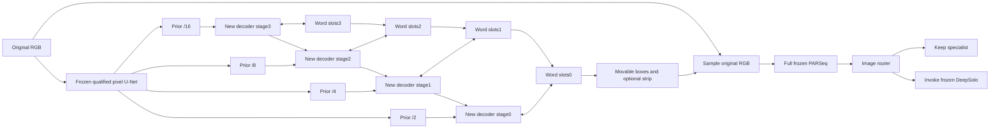

# Multi-scale word slots and complementary DeepSolo routing

This is a user-authorized **approximate reproduction / research extension**. It
does not alter the STRICT architecture, original scoring policy, or model defaults.
The scientific question is whether an independently trainable U-Net specialist
can recover words missed by the same frozen DeepSolo, with acceptable false
positives, and whether a deployable selector retains that complementarity.

The user subsequently requested comparison without symbols. The completed
[symbol-free reassessment](WORD_SLOT_ALPHANUMERIC.md) is the current comparison:
DeepSolo80.190%, descriptive new standalone best61.136%, and calibration-selected
word router79.793% F1. The original punctuation-retaining results below remain
historical evidence. The new path normalizes matching and refits TRAIN-only
selectors, preserving original readings, weights and the earlier report.

Implementation is in [word_slot_unet.py](../models/word_slot_unet.py),
[objectives](../segmentation/word_slot_objectives.py),
[teacher adapters](../recognition/word_slot_teachers.py),
[training runner](../scripts/run_word_slot_methods.py),
[evaluation](../scripts/evaluate_word_slot_methods.py),
[gate fitting](../scripts/analyze_word_slot_routers.py), and
[deployable routing](../recognition/word_slot_routing.py).
Decisions are classified in `WORD-SLOT-METHODS-001` in
[PAPER_AMBIGUITIES.md](PAPER_AMBIGUITIES.md).

## Architecture and controls

The complete qualified Text/Kernel U-Net is frozen, including its normalization
statistics, and is loaded without missing or unexpected tensors. Its four
FP32 feature maps are an immutable prior. A new progressive decoder projects and
refines each map, exchanges pixel context with independent word slots, and feeds
its conditioned pixels into the next resolution. Slot feedback therefore changes
the coarse-to-fine computation. This is different from adding heads to an
otherwise unchanged final U-Net feature map.



The diagram shows image-level fallback. Word-level selection evaluates both
experts before merging their outputs.

There are 128 slots, covering the observed TRAIN maximum of 117 care words.
At most 32 GT-blind kernel proposals initialize reference boxes; 96 slots remain
unseeded. Every box remains movable. Seed proposals do not restrict the possible
outputs. The backbone is not cold-started and its complete state is retained.
Inference uses no owner maps, annotations, denoising inputs, or teacher features.

RGB crops are sampled from original image pixels and passed through the complete
frozen qualified PARSeq encoder and decoder. OCR gradients reach crop geometry
and the new U-Net decoder. An optional content-conditioned upper/lower strip
changes the sampling grid. Zero offsets exactly reproduce the ordinary box
sampler. This strip is an explicit adaptation inspired by rectification work,
not an implementation or a reproduction claim for the original TPS++ model.

Two pixel-U-Net controls use the same crop cap: `pixel_control` uses the
continuous bilinear RGB box sampler, and `pixel_pil` uses the qualified PARSeq
PIL transform. Their difference quantifies the preprocessing intervention.
`slot_control` has the new decoder and ordinary instance supervision. All learned
branches share the same eight-epoch warmup, seed and qualified prior, followed by
three branch epochs. This is a fixed-budget, single-seed screen, not evidence of
convergence or a comparison of fully reproduced literature systems.

## Literature factors actually implemented

| Branch | Implemented adaptation | Boundary |
| --- | --- | --- |
| `denoising` | Noisy training-only geometry queries; isolated groups; background supervision | Inspired by [DNTextSpotter](https://arxiv.org/abs/2408.00355); no character/content-query replica |
| `mask_initialization` | Predicted mask moments initialize boxes, with denoising | [MaskDINO](https://arxiv.org/abs/2206.02777) adaptation; no COCO detector weights relabeled as U-Net weights |
| `recognition_alignment` | Frozen full-RGB PARSeq teacher-forced CE differentiates into boxes and slot decoder | Recognition/detection coupling inspired by [SwinTextSpotter v2](https://arxiv.org/abs/2401.07641); original recognizer is not substituted |
| `ccd_character` | Official frozen CCD-S backbone; character-bin contrastive alignment; repeated characters are not false negatives | [CCD](https://arxiv.org/abs/2211.00288) weights loaded strictly; uniform horizontal bins are an approximation to learned character masks |
| `mae_character` | Official Union14M MAE-pretrained ViT-S crop teacher under the same alignment objective | [Union14M](https://arxiv.org/abs/2307.08723); original RGB/bicubic/0.5 pretraining preprocessing, encoder-only teacher, not MAERec decoder replacing PARSeq |
| `siga_guidance` | Auxiliary glyph prediction guided by the strictly loaded CCD student segmentation teacher | [SIGA](https://arxiv.org/abs/2203.03382)-inspired adaptation; original SIGA checkpoint was obtained but its published repository lacks executable model code |
| `content_strip` | Content-conditioned differentiable RGB sampling strip with folding/outside/bending penalties | [TPS++](https://arxiv.org/abs/2305.05322)-inspired RGB adaptation; original feature-space rectifier is not claimed |
| `pcgrad` | Measured two-task gradient cosine, symmetric conflict projection, private-gradient preservation | [PCGrad](https://arxiv.org/abs/2001.06782); projection occurs only for a negative dot product |
| `dense_matching` | Diverse perturbed auxiliary query groups, independent one-to-one assignments, quality-target classification | Dense-matching / quality-target adaptation inspired by [DEIM](https://arxiv.org/abs/2412.04234); not its complete data or MAL recipe |
| `complementary_specialist` | Stronger care-word losses on spatial/exact errors of the frozen DeepSolo; ordinary background penalty retained | Residual expert training; no uncalibrated minimum between CE and word error |
| `multiple_choice` | Hard expert allocation on a common normalized word-edit risk, plus declared exploration CE | [Stochastic Multiple Choice Learning](https://proceedings.neurips.cc/paper/2016/hash/20d135f0f28185b84a4cf7aa51f29500-Abstract.html)-inspired fixed-expert adaptation; genuine AR student decoding is detached for allocation |
| `combined` | Denoising, CCD alignment, glyph guidance, OCR, strip, PCGrad and error specialization | Interaction arm; a gain cannot be assigned to one component |

`slot_control` is the thirteenth learned branch. Exact pinned source revisions,
checkpoint SHA256 values, copied/excluded tensor keys, import-only engineering
patches, and loading tests are saved with the run. No dependency was installed.
The MAE encoder pretraining recipe differs from the later MMOCR recognition
fine-tuning recipe. The initial ImageNet-normalized MAE cache is preserved as a
failed qualification artifact. Before the MAE branch started, a separate
`scripts/qualify_word_slot_mae_teacher.py` stage regenerated its targets using the
official `mae/main_pretrain.py` recipe: RGB, bicubic32x128, mean/std0.5. The active
cache, source evidence, hashes and correction receipt are explicit; no learned
branch uses the initial incorrect MAE cache. CCD and glyph targets are unchanged.
The maintained teacher runner now emits the correct MAE recipe directly and
rejects stale MAE preprocessing metadata. The recorded experiment keeps its
immutable v3 source plus the separate qualification receipt; fresh runs do not
need to generate an incorrect intermediate cache. Training-function ASTs are
unchanged by this maintained preprocessing fix.
The report validates either the historical corrected-target receipt or the
direct fresh teacher audit, including the required recipe. A failed historical
receipt cannot be hidden by another audit. Manual complete-stage reruns need no
fabricated supervisor state: warmup and every branch checkpoint/epoch contract
remain mandatory, and a present failed/incomplete supervisor remains an error.
No original model's headline benchmark score is transferred to these adaptations.

Multiple-choice allocation is an auxiliary training surrogate. Student words use
the supervised Hungarian assignment; frozen DeepSolo candidates are associated
by the declared spatial cutoff. Both reading costs use normalized edit distance,
but this asymmetric correspondence is not the exact routed set-level FP/FN
objective. Box/mask losses remain active and final selection uses the common
spatial/exact metric. Symmetric spatial-risk allocation is a distinct alternative,
not a claimed property of this adaptation.

DN queries cannot affect ordinary queries through self-attention **or through
pixel feedback**. Auxiliary dense groups use GT-independent reference jitter;
otherwise repeated identical queries would not provide a meaningful dense
matching intervention. Normal inference always uses one group. Unit tests cover
both boundaries.

## Data, metrics and routing

The explicit roles are FIT1030/7500 care words, calibration100/802, reused
evaluation125/983, and official TEST300/2204. Slot branches train on FIT only.
The original frozen prior historically saw the broader official TRAIN; the
reused evaluation set and repeatedly explored TEST are not fresh validation.
Two known pixel-identical TRAIN/TEST pairs remain in primary results, with a
298-image sensitivity view. No failed or unreadable word is removed from a
metric denominator. Words with empty resized masks retain box supervision.

All experts use maximum one-to-one matching requiring **both** original-frame
bbox IoU >=0.5 and exact Unicode casefolded text, with punctuation retained.
For compatibility with the inherited evaluator, original-frame pixel edges are
truncated towards zero before metric IoU. Normalized-box NMS uses floating IoU;
integer truncation would make nearly all normalized boxes empty. Raw predicted
floating coordinates remain available for inspection.
GT is care-only and every output counts, including predictions in ignored
regions. Thus the harmonized DeepSolo number differs from its historical
polygon-ignore result. Empty predictions produce false negatives; empty text and
unmatchable geometry remain false-positive candidates. This is not official
Total-Text polygon evaluation and is not Table5 reproduction.

Each U-Net method has a cap of 20 emitted/OCR candidates before post-OCR
selection. Actual emitted counts, native confidence, unique crop tensors and
measured computation are retained. Equal caps do not imply identical realized
cost. Presence/confidence thresholds are chosen on calibration TRAIN only.
Independent crop-selection RNG avoids changing the sampled OCR supervision just
because another method also consumes denoising randomness.

The **image router** sees only student output features. Ridge utility estimates
balance recovered TP against extra emitted predictions; its inner folds select
student thresholds using fold-training images only. Its fixed-half view uses
the top-scoring half of a batch without GT. The **word router** runs both experts
and fits an image-grouped OOF quality model. It preserves DeepSolo, admits a
nonconflicting student word, or replaces a single geometric conflict when the
calibrated advantage clears TRAIN-selected thresholds. Many-to-many replacement
is not invented. Word-level selection therefore does not reduce DeepSolo calls.

The primary student is selected across learned branches using **OOF calibration
word-router F1**, with fewer changed outputs and declared branch order as ties.
Standalone calibration F1 is a secondary diagnostic. This selection rule is in
`configs/approximate/word_slot_analysis_v1.json`, recorded before full TEST
inference; it does not promote the descriptive TEST winner.
The secondary `configs/approximate/word_slot_controls_v1.json` comparator fits
only a confidence filter on the same frozen DeepSolo outputs. It checks whether
score calibration alone explains an apparent routing gain; it cannot reconstruct
detections below the original inference threshold and does not change the
primary fixed-expert protocol.

TRAIN and TEST reuse some `sample_id` strings for different RGB bytes. All source
joins use split-specific paths and verify image SHA256. Gates are fitted before
evaluation/TEST predictions are loaded. Tests deliberately collide sample IDs.
Deployment uses serialized scaler/regression coefficients without GT; its
callback boundary releases the student models before invoking real DeepSolo,
and propagates inference failures.

Live inference is available through `pipeline/word_slot_specialist.py` and
`scripts/run_word_slot_specialist.py`. It recomputes the frozen pixel prior and
GT-blind seed boxes from an arbitrary original RGB file, then uses the complete
PARSeq and saved gate coefficients. It does not read dataset owner maps or reuse
cached feature tensors. Use this adapter for trained inference: the model's
low-level `forward` is an unseeded research interface. A whole-image gate may
avoid DeepSolo; a word gate invokes the genuine isolated legacy adapter after
releasing the student. Callback or model failures remain errors.

## Reproduction and evidence

Use explicit external paths in
[word_slot_methods_v1.json](../configs/approximate/word_slot_methods_v1.json) and
[word_slot_router_v1.json](../configs/approximate/word_slot_router_v1.json).
Independent audit/report: `scripts/report_word_slot_methods.py`.
The isolated run stores a source snapshot, full resolved protocol, dataset and
feature-cache hashes, loading audits, epoch histories, learned decoder states,
frozen DeepSolo responses, sampled-mask/grid intermediates, per-image OCR,
threshold sweeps, gate decisions, memory peaks, failure receipts, and aggregate
word counts. Epoch-level resumes require the same code and configuration.

From the chosen immutable source snapshot, the entrypoints are:

```bash
python -m scripts.run_word_slot_methods --mode approximate --config CONFIG --output RUN --stage prepare
python -m scripts.run_word_slot_methods --mode approximate --config CONFIG --output RUN --stage warmup
# Run export_word_slot_deepsolo in the qualified legacy environment.
python -m scripts.run_word_slot_methods --mode approximate --config CONFIG --output RUN --stage deep
python -m scripts.run_word_slot_methods --mode approximate --config CONFIG --output RUN --stage teacher
# For a historical v3/stale MAE cache only, before its branch is initialized:
# python -m scripts.qualify_word_slot_mae_teacher --mode approximate --config MAE_TEACHER_CONFIG --run RUN
python -m scripts.run_word_slot_methods --mode approximate --config CONFIG --output RUN --stage train
python -m scripts.evaluate_word_slot_methods --mode approximate --config CONFIG --output RUN --stage infer
python -m scripts.evaluate_word_slot_methods --mode approximate --config CONFIG --output RUN --stage summarize
python -m scripts.analyze_word_slot_routers --mode approximate --config ROUTER_CONFIG --output RUN
python -m scripts.report_word_slot_methods --mode approximate --config ANALYSIS_CONFIG --controls-config CONTROLS_CONFIG --run RUN
python -m scripts.run_word_slot_specialist --mode approximate --run RUN --image RGB_FILE --router-kind image --output FRESH_OUTPUT
```

`MAE_TEACHER_CONFIG` is `configs/approximate/word_slot_mae_teacher_v2.json`.
`CONTROLS_CONFIG` is `configs/approximate/word_slot_controls_v1.json`.
Set the declared `CUBLAS_WORKSPACE_CONFIG` before Python. Actual host hardware is
an RTX3090/24GiB; FP32 microbatch1, accumulation4, sequential legacy processes and
CPU grid backward are recorded hardware deviations. This does not qualify an
8GiB GPU, original paper latency, or a fully trained literature system.

Qualification exposed and corrected nondeterministic CUDA linear-grid backward,
the exact lowercase CCD segmentation namespace, split-ID joins, normalized-box
NMS and the MAE pretraining-versus-fine-tuning preprocessing distinction. The OOM
error path is tested by injection and propagates with an explicit failure
receipt; measured successful runs report actual allocated/reserved peaks and
whether an OOM occurred. Historical failed smoke receipts remain preserved.

## Original punctuation-retaining experiment, 2026-10-25

All13 learned branches and both pixel controls completed training/inference and
evaluation. **The intended routed improvement was not achieved.** The new decoder
creates complementary hypotheses, but no selected router improves on the frozen
DeepSolo. No checkpoint or routing policy is promoted.

| Endpoint | TEST micro word F1 % | Interpretation |
| --- | ---: | --- |
| Frozen DeepSolo | 78.836 | Same checkpoint, harmonized spatial/exact protocol |
| Frozen pixel U-Net + PIL/PARSeq | 57.227 | Best standalone control |
| Recognition alignment | 57.200 | Descriptive best new branch; not TEST-selected |
| Dense matching alone | 56.365 | Primary student selected by OOF calibration routed F1 |
| Primary word router | 77.935 | Both experts on all300 images |
| Primary image router | 76.249 |221 logical DeepSolo calls |
| Primary image router, fixed half | 73.989 |150 logical DeepSolo calls |

The primary student's89 exclusive GT matches show a useful candidate population,
but its selected word gate admits only12 true words with70 false positives and
loses0 DeepSolo-correct words. Admission precision drops from55% on20 OOF
calibration additions to14.63% on82 TEST additions. For conflict-free additions,
the count-derived precision needed to improve this baseline F1 is39.42%. The
paired image-bootstrap interval for the routed difference is[-1.427,-0.466]
percentage points; it is conditional on these fitted models and selected data.
The image gate additionally loses80 correct DeepSolo words.23 of the primary
student's89 exclusive matches contain punctuation outside DeepSolo's alphabet;
the other66 show complementarity within the shared alphabet. A visual annotation
discrepancy in TEST399 remains unresolved; raw labels and metrics are preserved.

The calibration-only DeepSolo score-filter control reaches79.324% F1 by removing
184FP while losing103TP. It recovers no new words and does not satisfy the
specialist objective. Equal20-crop caps also conceal different realized costs:
each learned branch processes6000 TEST crops versus2597 for each pixel control.

All67 focused/regression tests pass. Independent Hungarian matching verifies
33900 image/method cases, with no alternate matched-GT identity disagreements.
Three actual uncached RGB smoke cases exercise U-Net acceptance, real isolated
DeepSolo fallback and word merging; their20 crop tensors, boxes, text and
confidence values exactly reproduce the saved evaluation output. The first live
smoke exposed retained PARSeq CUDA weights after reference release. Explicitly
moving both models to CPU before dropping references fixed cleanup, and the final
GPU diagnostic finds no remaining CUDA tensors. This sequential unloading is a
documented HARDWARE_DEVIATION; the original functional smoke remains archived.

Student live peaks are595167232 allocated /683671552 reserved bytes; the isolated
DeepSolo worker reports1172747264 /2420113408 bytes. Shapes, batch, FP32 precision,
hardware and OOM status are saved per stage. These few smoke inputs do not qualify
an8GiB GPU or full deployment latency.

Portable numerical evidence, source/result hashes and limitations are in
[word_slot_methods_v1_completion.json](../provenance/word_slot_methods_v1_completion.json).
The complete external report, all15 method rows, paired routing comparisons,
per-word CSV and reviewed figures are under
`/extra1/bmartelli/context-str-runs/word-slot-methods-20261024-v1/study/`.
The report distinguishes implemented adaptations from original literature models.
The short one-seed screen leaves decoder convergence unresolved; fresh expert
predictions and independent router calibration are needed before claiming
generalization. STRICT reproduction remains unchanged and unresolved.

Focused checks: `tests/models/test_word_slot_unet.py` and
`tests/recognition/test_word_slot_methods.py`.
